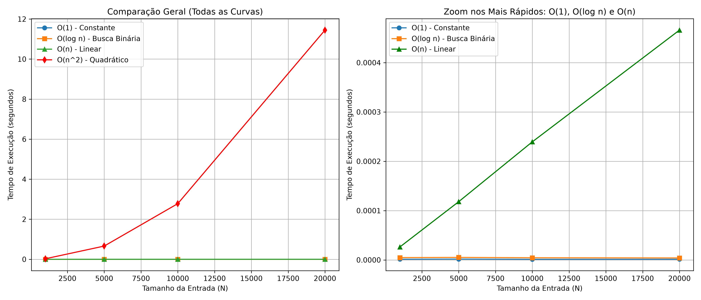

# Grupo 4 — Eficiência e Complexidade de Algoritmos (Notação Big-O)
> Trabalho acadêmico desenvolvido para a disciplina de Fundamentos da computação.

---

## 📌 Objetivo
Medir na prática como o tempo de execução de diferentes algoritmos cresce com o aumento do tamanho da entrada ($N$) e correlacionar os resultados com a notação teórica **Big-O**.

---

## 🧠 Notação Big-O: Teoria vs. Prática

* **Na Teoria:** O Big-O mede o **número de operações fundamentais** (passos lógicos) executados pela CPU no pior caso. É independente de hardware (uma máquina antiga e um supercomputador realizam exatamente os mesmos passos lógicos).
* **Na Prática:** Usamos a função `perf_counter` da biblioteca `time` do Python para medir o tempo real em segundos, comprovando empiricamente que o relógio da máquina acompanha o formato das curvas teóricas.

---

## ⚙️ Os 4 Algoritmos Principais & Analogias do Cotidiano

| Complexidade | Nome | O que a função faz | Analogia do Cotidiano |
| :--- | :--- | :--- | :--- |
| **$O(1)$** | **Tempo Constante** | Acessa direto o índice 0 da lista (`lista[0]`). | **Pegar o prato do topo:** Não importa se a pilha tem 3 ou 500 pratos, você só pega o prato de cima em um único movimento. |
| **$O(\log n)$** | **Tempo Logarítmico** | Busca Binária em lista previamente ordenada. | **Palavra no dicionário:** Abre no meio; se a palavra está depois, descarta a metade anterior. Corta o problema pela metade a cada passo. |
| **$O(n)$** | **Tempo Linear** | Percorre a lista somando todos os elementos. | **Achar uma meia na gaveta bagunçada:** Sem ordem, você precisa olhar item por item. O tempo cresce em linha reta com a quantidade de peças. |
| **$O(n^2)$** | **Tempo Quadrático** | Dois laços `for` aninhados comparando todos os pares. | **Cumprimentar todos numa festa:** Em uma festa com $N$ pessoas, cada uma aperta a mão de todas as outras ($N \times N$). O trabalho se multiplica por ele mesmo. |

---

## 📊 Gráficos Gerados

O script `algoritmos.py` testou tamanhos de entrada $N = [1.000, 5.000, 10.000, 20.000]$ e gerou o gráfico comparativo:



### Análise dos Resultados:
1. **Gráfico Geral (Esquerda):** A curva vermelha do $O(n^2)$ dispara como uma parábola. Com $N = 20.000$, foram $20.000 \times 20.000 = 400.000.000$ operações, consumindo cerca de 15 segundos. Isso faz com que $O(1)$, $O(\log n)$ e $O(n)$ pareçam colados no eixo zero.
2. **Gráfico de Zoom (Direita):** Ao isolar os três mais rápidos, vemos que o $O(n)$ forma uma reta diagonal perfeita (linear), enquanto $O(1)$ e $O(\log n)$ mantêm-se ultrarrápidos e quase planos.

---

## 💥 Desafio Extra: Algoritmo $O(2^n)$ (Tempo Exponencial)

Implementado no script `desafio_o2n.py` gerando todos os subconjuntos de uma lista (Power Set). A cada novo elemento, a quantidade total de combinações **dobra** ($2^n$).

### Resultados do Teste Prático:
| Tamanho $N$ | Subconjuntos Gerados ($2^n$) | Tempo de Execução |
| :---: | :---: | :---: |
| **5** | 32 | 0,00001 s |
| **10** | 1.024 | 0,00016 s |
| **15** | 32.768 | 0,00716 s |
| **20** | 1.048.576 (~1 milhão) | 0,31049 s |
| **22** | 4.194.304 (~4 milhões) | 1,45284 s |
| **24** | 16.777.216 (~16 milhões) | 6,07989 s |

### ⚠️ Onde ele se torna inviável?
* **Entre $N = 25$ e $N = 30$**.
* Para $N = 30$, seriam gerados mais de **1 bilhão de subconjuntos**, o que exigiria mais de **30 GB de memória RAM**, gerando o erro de falta de memória (`MemoryError`) e travando o sistema.
* Para $N = 1.000$ (tamanho comum usado nos outros algoritmos), $2^{1000}$ supera a quantidade de átomos no universo observável.

---

## 🎯 Pergunta da Apresentação: E com 1 Bilhão ($10^9$) de Elementos?

Considerando um processador moderno capaz de realizar cerca de $10^9$ operações básicas por segundo:

| Algoritmo | Fórmula de Passos | Operações para $N = 10^9$ | Tempo Estimado |
| :--- | :--- | :--- | :--- |
| **$O(1)$** | $1$ | 1 operação | $\approx 1 \text{ nanossegundo}$ (Instantâneo) |
| **$O(\log n)$** | $\log_2(10^9)$ | $\approx 30$ operações | $\approx 30 \text{ nanossegundos}$ (Instantâneo) |
| **$O(n)$** | $N$ | $1.000.000.000$ operações | $\approx \mathbf{1 \text{ segundo}}$ |
| **$O(n^2)$** | $N^2$ | $10^{18}$ operações | $\approx 10^9 \text{ s} \approx \mathbf{31,7 \text{ ANOS}}$ |
| **$O(2^n)$** | $2^N$ | $2^{10^9}$ operações | **Inviável** (superior ao tempo de vida do universo) |

---

## 🚀 Como Executar o Projeto

1. **Executar a medição dos 4 algoritmos e gerar os gráficos:**
   ```bash
   python algoritmos.py
   ```
   *Irá executar os benchmarks e salvar a imagem `grafico_complexidade.png`.*

2. **Executar o teste do algoritmo exponencial $O(2^n)$:**
   ```bash
   python desafio_o2n.py
   ```
